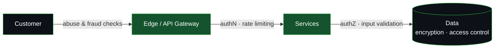
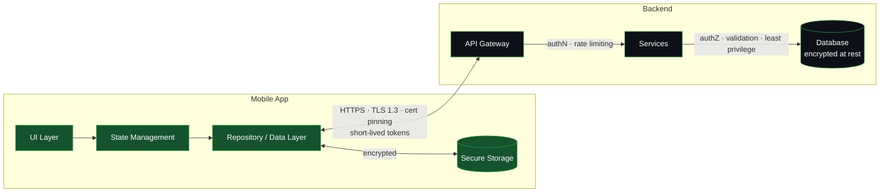
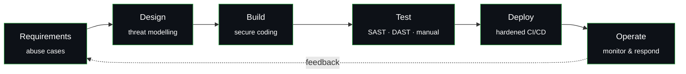
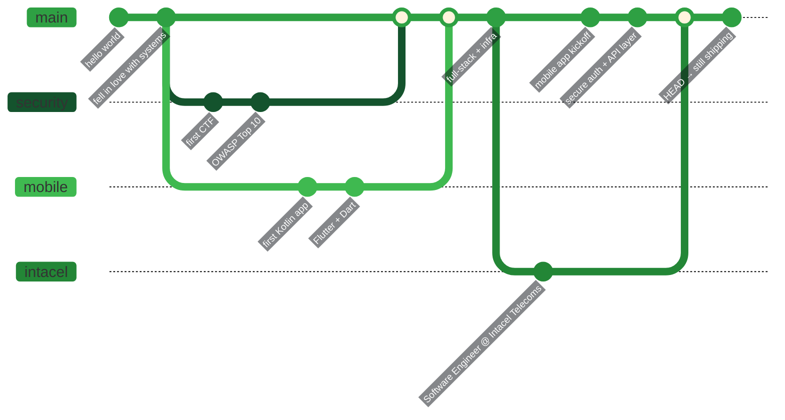

<!--
  ╔══════════════════════════════════════════════════════════════════╗
  ║  acunetix2 :: profile README                                     ║
  ║  If you're reading the source: hi. You're my kind of person.     ║
  ║  Security tip: always read the source. (You just did.)           ║
  ╚══════════════════════════════════════════════════════════════════╝
-->

<div align="center">

<picture>
  
</picture>


<br/>

<a href="https://github.com/acunetix2"></a>
<a href="https://github.com/acunetix2?tab=followers"></a>

<br/>


</div>

---

```console
┌──(iddy㉿intacel)-[~]
└─$ cat /etc/profile.d/iddy.conf

  NAME        = "Iddy Chesire"
  HANDLE      = "acunetix2"
  ROLE        = "Software Engineer"
  EMPLOYER    = "Intacel Telecoms"
  LOCATION    = "Kenya (EAT, UTC+3)"
  DISCIPLINES = ["Application Security", "Software Engineering", "Mobile Development"]
  BUILDING    = "Mobile app @ Intacel Telecoms"
  MOTTO       = "Engineered properly. Secured by design. Built to last."
  STATUS      = ● online — open to collaboration

└─$ uptime
  shipping code, breaking it on purpose, then fixing it properly.
```

---

## Table of Contents

<table>
<tr>
<td valign="top" width="33%">

**About**
- [Who I Am](#who-i-am)
- [At a Glance](#at-a-glance)
- [Intacel Telecoms](#currently--software-engineer--intacel-telecoms)
- [Profile as Code](#profile-as-code)

</td>
<td valign="top" width="33%">

**Work**
- [Now Building: Intacel Mobile App](#now-building--mobile-app--intacel-telecoms)
- [Application Security](#application-security)
- [Software Engineering](#software-engineering)
- [Mobile Development](#mobile-development)

</td>
<td valign="top" width="33%">

**Everything Else**
- [Tech Stack](#tech-stack--tools)
- [Engineering Principles](#engineering-principles)
- [Journey](#the-journey-as-a-git-graph)
- [Stats](#github-statistics)
- [Connect](#lets-connect)

</td>
</tr>
</table>

---

## Who I Am

I'm a **Software Engineer at Intacel Telecoms** with three specialisms: **Application Security, Software Engineering and Mobile Development**. Most engineers pick one of these. I use all three together because they make each other better:

> **I build systems the way an attacker would want to break them, and then I make sure they can't.**

| Discipline | What it means in practice |
|---|---|
| **Application Security** | Understanding vulnerabilities, mapping attack surfaces, running security tests, and building security into every stage of the SDLC instead of adding it at the end. |
| **Software Engineering** | Designing and building scalable applications, backend services, APIs, enterprise systems, and dependable software architectures. |
| **Mobile Development** | Shipping native Android apps with **Kotlin** and cross-platform apps with **Flutter & Dart**. |

I also work across **networking, infrastructure, databases and deployment pipelines**. I like knowing how systems work internally, all the way down to the packet, the query plan and the syscall, because that is where the real weaknesses and the real fixes are.

I believe good software should **solve a real problem**, be **engineered properly**, be **secured by design**, and be **built to last**.

---

## At a Glance

<div align="center">
<table>
<tr>
<td width="20%" align="center">
<strong>Role</strong><br/>
<sub>Software Engineer<br/>@ Intacel Telecoms</sub>
</td>
<td width="20%" align="center">
<strong>Building</strong><br/>
<sub>Mobile App<br/>@ Intacel</sub>
</td>
<td width="20%" align="center">
<strong>Specialisation</strong><br/>
<sub>Application<br/>Security</sub>
</td>
<td width="20%" align="center">
<strong>Mobile</strong><br/>
<sub>Kotlin &<br/>Flutter</sub>
</td>
<td width="20%" align="center">
<strong>Interests</strong><br/>
<sub>Systems &<br/>Architecture</sub>
</td>
</tr>
</table>
</div>

---

## Currently — Software Engineer @ Intacel Telecoms

<a href="#"></a>


At **Intacel Telecoms** I work on the software behind telecom operations. In telecom, uptime, data integrity and security are basic requirements.

**What I bring to the role**

- **Backend & service engineering**: building and maintaining services and APIs that support day-to-day telecom operations.
- **Security-minded development**: applying AppSec practice (authN/authZ, input validation, secure session handling, least privilege) to production systems.
- **Networking & infrastructure awareness**: knowing how the network layer underneath the software actually behaves.
- **Data & reliability**: database design, query optimisation, and systems that degrade gracefully instead of failing loudly.
- **Delivery**: CI/CD, containerisation and deployment workflows that make releases routine.

<details>
<summary><b>Why telecom + security is a good fit for me (click to expand)</b></summary>
<br/>

Telecom systems sit on a large attack surface: customer data, billing, provisioning, network management interfaces and many integrations. Each one is a trust boundary. My AppSec background means I build with those boundaries in mind from the first commit:



Every arrow is a place where something can go wrong. My job is to make sure it doesn't.

</details>

---

## Profile as Code

<details open>
<summary><b>Kotlin</b> (because I ship Android)</summary>

```kotlin
data class Engineer(
    val name: String,
    val role: String,
    val company: String,
    val location: String,
    val disciplines: List<String>,
    val building: String,
    val principles: List<String>,
)

val iddy = Engineer(
    name        = "Iddy Chesire",
    role        = "Software Engineer",
    company     = "Intacel Telecoms",
    location    = "Kenya",
    disciplines = listOf("Application Security", "Software Engineering", "Mobile Development"),
    building    = "Mobile app @ Intacel Telecoms",
    principles  = listOf(
        "Solve a real problem",
        "Engineer it properly",
        "Secure it by design",
        "Build it to last",
    ),
)

fun main() = println("Hello from ${iddy.name} @ ${iddy.company} ")
```

</details>

<details>
<summary><b>Dart / Flutter</b></summary>

```dart
class Engineer {
  final String name = 'Iddy Chesire';
  final String role = 'Software Engineer @ Intacel Telecoms';
  final List<String> stack = ['Kotlin', 'Flutter', 'Python', 'TypeScript'];

  Stream<String> get dailyLoop async* {
    yield 'design';
    yield 'build';
    yield 'break (on purpose)';
    yield 'secure';
    yield 'ship';
  }
}
```

</details>

<details>
<summary><b>Python / FastAPI</b></summary>

```python
from fastapi import FastAPI, Depends
from fastapi.security import OAuth2PasswordBearer

app = FastAPI(title="iddy.api", version="2026.11")
oauth2 = OAuth2PasswordBearer(tokenUrl="token")  # secured by design, always

@app.get("/whoami")
async def whoami(token: str = Depends(oauth2)):
    return {
        "name": "Iddy Chesire",
        "role": "Software Engineer",
        "company": "Intacel Telecoms",
        "focus": ["AppSec", "Backend", "Mobile"],
        "building": "Mobile app @ Intacel Telecoms",
    }
```

</details>

<details>
<summary><b>YAML</b> (for the infra people)</summary>

```yaml
apiVersion: people/v1
kind: Engineer
metadata:
  name: iddy-chesire
  labels:
    role: software-engineer
    company: intacel-telecoms
    region: east-africa
spec:
  replicas: 1            # one of one
  securityContext:
    runAsNonRoot: true   # least privilege, even for humans
    readOnlyRootFilesystem: true
  containers:
    - name: appsec
    - name: software-engineering
    - name: mobile
  livenessProbe:
    exec: ["coffee", "--strong"]
```

</details>

---

## Now Building — Mobile App @ Intacel Telecoms


Right now I'm building a **mobile application at Intacel Telecoms**. I'm bringing together all three of my disciplines: **mobile engineering** for the app itself, **software engineering** for the backend and APIs behind it, and **application security** for the data and accounts it handles.


#### How I'm approaching it

| Pillar | What it means for the app |
|---|---|
| **Polished UX** | Fast, clean, accessible interfaces that feel native on every device |
| **Secure by design** | Secure token handling, encrypted local storage, hardened auth flows, no secrets in the client |
| **Reliable networking** | Solid API integration, sensible retries and caching, graceful offline behaviour |
| **Maintainable architecture** | Clear layering and state management, reusable components, testable code |
| **Performance** | Fast startup, smooth scrolling, low battery and data usage on all networks |
| **Delivery** | CI/CD, automated checks, and dependable release pipelines |

#### Architecture at a glance



#### Mobile toolkit

<p>


</p>

<sub>This is company work, so the source code is private. This section describes my approach, not proprietary details.</sub>

---

## Application Security

I'm interested in how applications and infrastructure are **attacked, assessed and secured**, and I put that into the code I write every day.

```text
  ╔═════════════════════════════════════════════════════════════════════╗
  ║  ADVISORY  ACX2-2026-001                     SEVERITY: ██████ HIGH  ║
  ╠═════════════════════════════════════════════════════════════════════╣
  ║  Component : Any system Iddy builds                                 ║
  ║  Finding   : Security has been integrated from design onward.       ║
  ║  Impact    : Attackers report significantly reduced job satisfaction║
  ║  Remediation: None required. Working as intended.                   ║
  ╚═════════════════════════════════════════════════════════════════════╝
```

### Areas of focus

| Area | Focus |
|---|---|
| **Vulnerability Assessment** | Web application security, vulnerability identification, attack-surface mapping, security testing |
| **Secure Engineering** | Authentication, authorisation, API security, session management, input validation |
| **Network & Infrastructure Security** | Network analysis, Linux, system hardening, infrastructure security, monitoring |
| **Mobile Security** | Secure storage, transport security, auth flows and app hardening on Android & Flutter |

### How I build security into the SDLC



<details>
<summary><b>The OWASP Top 10 lens I apply to every review</b></summary>
<br/>

| # | Risk | What I check |
|:-:|---|---|
| 01 | Broken Access Control | Is every object-level and function-level access check enforced server-side? |
| 02 | Cryptographic Failures | Is sensitive data encrypted in transit and at rest, with sound key handling? |
| 03 | Injection | Are queries parameterised and all input validated and encoded? |
| 04 | Insecure Design | Was this threat-modelled, or only built? |
| 05 | Security Misconfiguration | Defaults removed, headers set, debug off? |
| 06 | Vulnerable Components | Are dependencies pinned, scanned and up to date? |
| 07 | Identification & Auth Failures | MFA, rate limiting, secure session lifecycle? |
| 08 | Software & Data Integrity | Signed builds, trusted pipelines, verified updates? |
| 09 | Logging & Monitoring Failures | Would we actually *notice* an attack? |
| 10 | SSRF | Can user input make the server fetch something it shouldn't? |

</details>

### Security training grounds

<p>
<a href="https://tryhackme.com/"></a>
<a href="https://www.hackthebox.com/"></a>
<a href="https://portswigger.net/web-security"></a>
<a href="https://owasp.org/"></a>
</p>

---

## Software Engineering

I build across the **frontend, backend and infrastructure** layers, with a focus on maintainability, performance and dependable system design.

<table>
<tr>
<td width="50%" valign="top">

#### Build
- Full-stack web application development
- Backend engineering & REST API design
- Enterprise application architecture
- Authentication & authorisation systems

</td>
<td width="50%" valign="top">

#### Run
- Database design, modelling & optimisation
- CI/CD pipelines & deployment workflows
- Containerisation & infrastructure
- Performance, scalability & reliability

</td>
</tr>
</table>

---

## Mobile Development

I build mobile applications with both **native** and **cross-platform** technologies, and I choose based on what the product needs.

<table>
<tr>
<td width="50%" valign="top">

###  Kotlin — Native Android

- Kotlin & Android Studio
- Native Android development
- Android UI development
- API integration
- Local data persistence
- Authentication & security
- Application lifecycle management

</td>
<td width="50%" valign="top">

###  Flutter — Cross-platform

- Dart & Flutter
- Cross-platform UI development
- State management
- REST API integration
- Authentication
- Reusable components
- Application optimisation

</td>
</tr>
</table>

| When I choose **Kotlin** | When I choose **Flutter** |
|---|---|
| Deep platform integration, background services, hardware access | One codebase for Android + iOS on a tight timeline |
| Maximum performance & native feel on Android | Highly custom, consistent UI across platforms |
| Android-first products | MVPs and fast iteration |

---

## Tech Stack & Tools

<div align="center">

<table>
<tr>
<td colspan="2" width="100%" align="center" valign="top">
<br/>
<b>LANGUAGES</b>
<br/><br/>

<br/>
<sub>JavaScript · TypeScript · Python · Java · Kotlin · Dart · C · C++ · HTML · CSS</sub>
<br/><br/>
</td>
</tr>
<tr>
<td width="50%" align="center" valign="top">
<br/>
<b>FRONTEND</b>
<br/><br/>

<br/>
<sub>React · Next.js · Tailwind · Vite · jQuery</sub>
<br/><br/>
</td>
<td width="50%" align="center" valign="top">
<br/>
<b>MOBILE</b>
<br/><br/>

<br/>
<sub>Kotlin · Android Studio · Flutter · Dart</sub>
<br/><br/>
</td>
</tr>
<tr>
<td width="50%" align="center" valign="top">
<br/>
<b>BACKEND</b>
<br/><br/>

<br/>
<sub>Node.js · Deno · Express · .NET · FastAPI</sub>
<br/><br/>
</td>
<td width="50%" align="center" valign="top">
<br/>
<b>DATABASES &amp; CLOUD</b>
<br/><br/>

<br/>
<sub>PostgreSQL · MySQL · MongoDB · Firebase · Supabase · GCP</sub>
<br/><br/>
</td>
</tr>
<tr>
<td width="50%" align="center" valign="top">
<br/>
<b>DEVOPS &amp; TOOLING</b>
<br/><br/>

<br/>
<sub>Docker · Git · GitHub · Actions · Vercel · Netlify · VS Code · Postman</sub>
<br/><br/>
</td>
<td width="50%" align="center" valign="top">
<br/>
<b>SECURITY &amp; NETWORKING</b>
<br/><br/>

<br/>
<sub>Linux · Kali · Bash · Wireshark</sub>
<br/><br/>
</td>
</tr>
</table>

<br/>


</div>

---

## Engineering Principles

```diff
+ Solve a real problem before writing a single line of code.
+ Security is a design decision, not a release-week checklist.
+ Least privilege for services, tokens, databases and people.
+ Make it work, make it right, make it fast, in that order.
+ Measure before optimising. Log before guessing.
+ Readable code is maintainable code. Maintainable code is secure code.
+ Automate anything you do twice.
- "It works on my machine."
- "We'll add auth later."
- Secrets committed to the repo.
```

---

## The Journey (as a git graph)



---

## GitHub Statistics

<div align="center">


<br/><br/>


</div>

---

## Contribution Activity

<div align="center">

<picture>
  <source media="(prefers-color-scheme: dark)" srcset="https://raw.githubusercontent.com/acunetix2/acunetix2/output/github-contribution-grid-snake-dark.svg"/>
  <source media="(prefers-color-scheme: light)" srcset="https://raw.githubusercontent.com/acunetix2/acunetix2/output/github-contribution-grid-snake.svg"/>
  
</picture>

</div>

---

## Let's Connect

I'm always happy to connect with **developers, security people, telecom engineers** and anyone building meaningful technology, especially in **East Africa**.

<details>
<summary><b>Things you can talk to me about</b></summary>
<br/>

- Application security, secure code review, threat modelling
- Software in the telecom space
- Building and securing mobile apps for telecom users
- Kotlin vs Flutter, and when to use each
- System design and backend architecture
- CTFs, TryHackMe, Hack The Box and PortSwigger labs

</details>

<div align="center">

<a href="https://www.linkedin.com/in/iddy-chesire-55009b264/"></a>
<a href="https://x.com/mentoiddy"></a>
<a href="https://instagram.com/chesire.exe"></a>
<a href="https://youtube.com/@montgomery-v5w"></a>
<a href="mailto:iddychesire098@gmail.com"></a>

<br/><br/>


<br/><br/>

```console
└─$ echo "Thanks for visiting. Now go secure something." && logout
```


</div>
